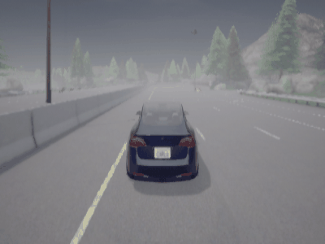

# CARLA Lane Keeping — Full Method

A CARLA-based lane-keeping project using Double DQN with action-space curriculum (PG-ASC), decaying action repetition (DAR), asymmetric reward shaping (ARRS), and reward-aware prioritized replay (RD-PER).



## Setup

Requires **CARLA 0.9.16** and Python with the CARLA API.

```bash
pip install -r code/requirements.txt
```

## Run

Start CARLA, then run training or the included driving demo:

```bash
python code/train.py --seed 1 --server-ip 127.0.0.1 --out outputs
python code/demo.py --device cuda
```

The demo uses the included `checkpoint_demo.pth`. A GUI-enabled OpenCV installation is required to display its window.

## License and citation

Archived release: [Zenodo DOI](https://doi.org/10.5281/zenodo.24279319). See [LICENSE](LICENSE) and [CITATION.cff](CITATION.cff).
